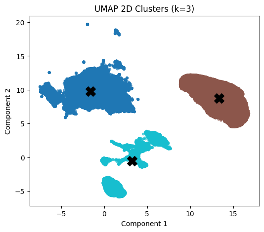
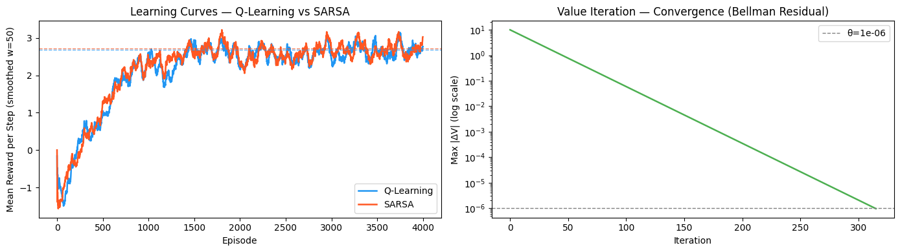
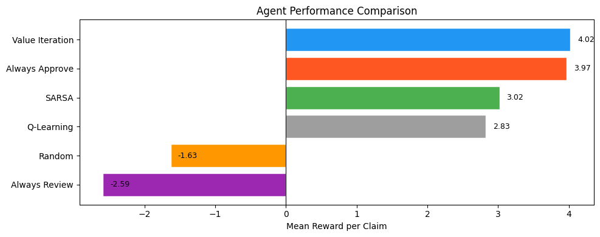

# Insurance Claims: Accelerated Approval with Unsupervised, Supervised & Reinforcement Learning

Academic project for **Machine Learning 2** (4th year, Statistics and Data Science, ENSSEA, 2025–2026).
The goal is to decide whether an insurance claim can be **fast-tracked (target = 1)** or needs **standard processing (target = 0)**, using three ML paradigms on one dataset of 114,321 claims and 131 features.

| Part | Paradigm | Tools | Deliverable |
|------|----------|-------|-------------|
| I | Unsupervised learning (PCA, UMAP, KMeans++, GMM) | Python | `notebooks/unsupervised_and_rl.ipynb` |
| II | Supervised learning (Logistic Regression, Random Forest, XGBoost, LightGBM) | R, **Tidymodels** | `notebooks/supervised.Rmd` |
| III | Reinforcement learning (Q-Learning, SARSA, Value Iteration) | Python | `notebooks/unsupervised_and_rl.ipynb` |

The full write-up is in [`report/ML_Report_Kerrouche_Abdenacer.pdf`](report/ML_Report_Kerrouche_Abdenacer.pdf).

---

## Repository structure

```
.
├── README.md
├── .gitignore
├── data/
│   ├── data_compressed.zip       # raw dataset, zipped (114,321 x 133)
│   └── dataset_description.pdf   # data dictionary
├── notebooks/
│   ├── unsupervised_and_rl.ipynb # Parts I and III (Python)
│   ├── unsupervised_and_rl.html  # rendered version with outputs
│   └── supervised.Rmd            # Part II (R / Tidymodels)
├── report/
│   └── ML_Report_Kerrouche_Abdenacer.pdf
└── outputs/
    ├── Unsupervised/             # PCA, UMAP, clustering figures
    ├── Supervised/               # EDA and model comparison figures
    └── RL/                       # learning curves, policies, comparisons
```

---

## Dataset

- 114,321 claims, 131 features (19 categorical, 112 numeric) plus ID and binary target.
- Class balance: about **76% target = 1** and 24% target = 0.
- About 40–45% missing values across most features, which looks like a structured (non-random) pattern.
- `claim_detail_code` has 18,210 distinct levels.
- Data dictionary: [`data/dataset_description.pdf`](data/dataset_description.pdf).

The raw data was provided by the course instructor and is included in [`data/`](data/) with his permission as a ZIP file (`data_compressed.zip`). Unzip it before running the notebooks; the cleaned data is regenerated by the Part I pipeline.

---

## Part I: Unsupervised learning

**Pipeline:** type casting and downcasting (memory from 118.5 MB to 50 MB), removal of 8 near-duplicate features (|r| > 0.98), layered missing-value handling (drop columns with more than 45% missing, keep NaN as a `Missing` class for categoricals, Random Forest–based `IterativeImputer` for numerics), `StandardScaler`, PCA, UMAP, then KMeans++ and GMM.

**Key findings**

- `RobustScaler` made PC1 absorb about 98% of the variance, so `StandardScaler` was used instead.
- PCA on 104 numeric features: **15 components for 80%**, 25 for 90% and 34 for 95% of the variance.
- KMeans++ and GMM both indicate **k = 3** clusters in UMAP space (silhouette and Davies-Bouldin agree).
- The target is **not geometrically separable**: silhouette against the target is about 0.0004. The clusters describe claim profiles, not the approval label.

<p align="center">
  
  
</p>

---

## Part II: Supervised learning (Tidymodels)

**Setup:** 30% sample (32,861 rows), stratified 70/30 split (`set.seed(2026)`), 5-fold stratified CV, PR-AUC as the primary metric because of class imbalance.

**Recipe:** `step_zv`/`step_nzv` → `step_novel` → `step_other` → `step_lencode_glm` for `claim_detail_code` → `step_dummy` → `step_lincomb` → `step_corr (0.90)` → `step_normalize` → `step_smote` (training only, last).

**Test-set results (base models)**

| Model | Accuracy | F1 | ROC-AUC | PR-AUC |
|-------|---------:|---:|--------:|-------:|
| Logistic Regression | 0.630 | 0.476 | 0.718 | 0.439 |
| Random Forest | 0.754 | 0.352 | 0.722 | 0.444 |
| **XGBoost** | 0.767 | 0.347 | **0.725** | **0.472** |
| LightGBM | 0.767 | 0.343 | 0.721 | 0.470 |

**Tuning:** Random Forest improved slightly (PR-AUC 0.448). Tuned XGBoost and LightGBM improved F1 marginally but **lost a lot of ROC-AUC** (0.58 and 0.56), so the **untuned XGBoost was kept as the final model**.

**Top predictors:** `prior_denial_indicator`, `provider_network_status`, `customer_segment`, `claim_channel`, `recovery_probability`, `claim_processing_days`. Behavioral and operational features matter more than monetary ones.

<p align="center">
  
  
</p>

---

## Part III: Reinforcement learning

- **State:** quantile-discretized PCA scores from Part I.
- **Actions:** Fast-Track, Request Docs, Manual Review, Deny.
- **Rewards:** asymmetric, for example +10 for a correct fast-track, −20 for fast-tracking a risky claim, −15 for wrongly denying a legitimate claim, and small costs for delays.
- **Algorithms:** Q-Learning, SARSA (4,000 episodes, ε decaying 1.0 → 0.05, γ = 0.99) and Value Iteration (converged in about 320 iterations).

**Mean reward per claim:** Value Iteration 4.02, Always Approve 3.97, SARSA 3.02, Q-Learning 2.83, Random −1.63, Always Review −2.59.

Always Approve scores close to Value Iteration because 76% of claims are fast-trackable. The Q-Learning and SARSA agents use all four actions and assign Request Docs and Manual Review to specific regions of the PCA space, which a binary classifier cannot express.

<p align="center">
  
  
</p>

---

## Limitations and ideas for improvement

- Individual features are weak predictors (mean |r| with the target is about 0.02), so ROC-AUC plateaus near 0.72.
- Only a 30% sample was used for supervised learning.
- Ideas: threshold tuning with F-beta (β < 1) to reduce false fast-tracking, cluster labels as an extra feature, HDBSCAN for the irregular UMAP clusters, supervised UMAP, and reward shaping or warm-starting the RL agent from the supervised model.

---

## Reproducing

**Python (Parts I and III):** Python 3.10+ with `pandas`, `numpy`, `scikit-learn`, `umap-learn`, `matplotlib`, `seaborn`, `scipy`, `tqdm`, `jupyter`.

```bash
pip install -r requirements.txt
jupyter lab notebooks/unsupervised_and_rl.ipynb
```

**R (Part II):** R 4.3+ with `tidyverse`, `tidymodels`, `embed`, `themis`, `bonsai` (LightGBM), `xgboost`, `ranger`, `vip`, `pROC`, `ROCR`, `caret`, `patchwork`, `knitr`, `kableExtra`.

```r
rmarkdown::render("notebooks/supervised.Rmd")
```

Unzip `data/data_compressed.zip` into `data/` so that the CSV the notebooks read exists. Check the paths at the top of each notebook, since they may need adjusting after the folder reorganization.

---

## Author

**Kerrouche Abdenacer**, Master's student in Statistics and Data Science, ENSSEA
Course: Machine Learning 2 · Instructor: Ayoub Asri · Academic year 2025–2026
